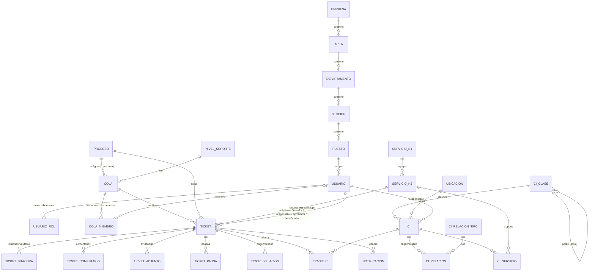
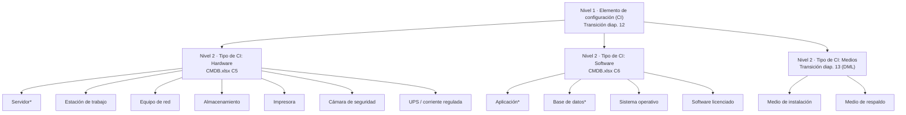

# Modelo de datos, jerarquía CMDB y mapeo de fuentes

Definición completa: `migrations/001`–`004`. Las tablas del parcial 2 se conservan sin cambios destructivos (la 003 solo amplía el `CHECK` de `usuario.rol`).

## 1. Diagrama entidad-relación (parcial 3)

## 2. Diccionario (tablas nuevas)
| Tabla | Clave | Columnas principales | Restricciones / notas |
|---|---|---|---|
| `usuario_rol` | (usuario_id, rol) | rol | Un usuario puede tener varios roles; el principal sigue en `usuario.rol`. |
| `proceso` | codigo | nombre, tipo_ticket, subtipo, orden | 7 filas fijas; `tipo_ticket` ∈ tipos de la diapositiva 14. |
| `nivel_soporte` | nivel | nombre, equivalencia, referencia_porcentaje, activo | Configurable (PUT `/api/niveles-soporte/{n}`). |
| `cola` | id | codigo **único**, nombre, descripcion, proceso_codigo, nivel_soporte, regla_orden, objetivo_primera_atencion_min, objetivo_resolucion_min, activo | Exactamente un proceso por cola. |
| `cola_miembro` | id | cola_id, usuario_id **o** rol, puede_consultar/atender/transferir/aprobar/administrar, activo | `CHECK` uno-de-dos; únicos por cola. |
| `ticket` | id | numero **único** (TK-nnnnnn), titulo, descripcion, solicitante_id, creador_id, servicio_n2_id, tipo_ticket, proceso_codigo, cola_id, responsable_id, estado, prioridad 1–4, impacto, urgencia, canal, nivel_soporte, categoria_evento, huella_evento, categoria_incidente, afectacion, duracion_estimada_min, duracion_real_min, redundancia_disponible, beneficiario_id, aprobado_por_id, aprobado_en, datos (JSONB del proceso), sin_ci_motivo, reaperturas, version, lote, creado_en, actualizado_en, primera_atencion_en, resuelto_en, cerrado_en | `huella_evento` única (no duplicar eventos); `CHECK` contra autoaprobación en ACCESO/CAMBIO; el N1 se deriva por `servicio_n2.servicio_n1_id` (no se guarda). |
| `ticket_bitacora` | id | ticket_id, actor_id, fecha, accion, anterior (JSONB), nuevo (JSONB), motivo | Trigger `tg_bitacora_inmutable`: no admite UPDATE ni DELETE. |
| `ticket_comentario` | id | texto, interno | `interno` solo visible para agentes/consulta/admin. |
| `ticket_adjunto` | id | nombre, tipo_mime, tamano ≤ 2 MB, sha256, contenido, interno | Tipos permitidos: pdf, png, jpeg, txt. Descarga autorizada en servidor. |
| `ticket_relacion` | id | origen_id, destino_id, tipo | Tipos: EVENTO_GENERA_INCIDENTE, INCIDENTE_DE_PROBLEMA, CAMBIO_CORRIGE_PROBLEMA, RELACIONADO, DUPLICADO_DE; validados por proceso. |
| `ticket_ci` | (ticket_id, ci_id) | | Un ticket sin CI guarda `sin_ci_motivo` (obligatorio en incidente, cambio y evento). |
| `ticket_pausa` | id | inicio, fin, motivo | Se abre al entrar a EN_ESPERA; descuenta del tiempo de resolución. |
| `notificacion` | id | usuario_id o cola_id, ticket_id, canal='APLICACION', mensaje | Notificación verificable (E2/E3, asignación, transferencia). |
| `kb_articulo` | id | titulo, contenido | FAQ de nivel 0. |
| `ci_clase` | id | codigo único, nombre, padre_id, nivel, denominacion, **origen**, requiere_ip, atributos (JSON) | Árbol sin ciclos (validación + trigger `tg_ci_clase_sin_ciclo`). |
| `ubicacion` | id | codigo, nombre, tipo, origen | Datos de referencia. |
| `ci` | id | codigo **único**, nombre, clase_id, columnas de CMDB.xlsx, atributos (JSON), lote, activo | Campos del Excel conservados (ver §4). IP solo en `atributos` de clases con `requiere_ip`. |
| `ci_relacion_tipo` | codigo | nombre, admite_ciclos, propaga_impacto, origen | DEPENDE_DE, ALOJADO_EN, COMPONENTE_DE (sin ciclos), CONECTADO_A (admite ciclos). |
| `ci_relacion` | id | origen_id, destino_id, tipo, lote | Única por (origen, destino, tipo); sin auto-relación. |
| `ci_servicio` | (ci_id, servicio_n2_id) | | Vincula CI con el catálogo. |

## 3. Jerarquía de la CMDB (grafo de clasificación)
Transcripción **antes** de programar, con fuente por nivel:

Nivel 3 = `DECISION_PROYECTO` (\* basada en ejemplos del Excel: B5/D5 «Servidor de Aplicaciones», B6/D6 «Aplicación de contabilidad», I5/I6 «Base de Datos1»).

| Nivel | Denominación | Valores | Origen (hoja/celda o diapositiva) |
|---|---|---|---|
| 1 | Elemento de configuración | CI | `Transicion.pptx.pdf` diap. 12 («Elemento de configuración CI»); diap. 11 («Identificación de CI (Id, Tipo)») |
| 2 | Tipo de CI | Hardware, Software | `CMDB.xlsx` hoja **CMDB**, encabezado C4 « Tipo de CI», valores C5 « Hardware», C6 « Software» |
| 2 | Tipo de CI | Medios | `Transicion.pptx.pdf` diap. 13 («CI's de medios», DML) |
| 3 | Clase | 13 clases | **DECISION_PROYECTO** (las fuentes no definen este nivel) |

**Diferencias entre fuentes:** el Excel solo muestra dos tipos (Hardware/Software) y la lección menciona además los CI de medios (DML); la lección 22 no se entregó como documento independiente y la nota editorial del enunciado advierte que su jerarquía no se verificó. Por eso no se atribuye a las fuentes ningún nivel 3; cada fila de `ci_clase` guarda su `origen` y la API `/api/cmdb/clases` lo muestra.

## 4. Mapeo de fuentes → implementación
### 4.1 CMDB.xlsx (hoja CMDB, B4:U6) → `ci`
| Col. | Encabezado | Columna | Tratamiento |
|---|---|---|---|
| B | Nombre del CI | `nombre`; `codigo` = `CMDB-<NOMBRE>` | Texto recortado (el Excel trae espacios iniciales). |
| C | Tipo de CI | `clase_id` (nivel 3 bajo HW/SW) | B5→Servidor, B6→Aplicación (decisión documentada). |
| D | Descripción | `descripcion` | |
| E | Número de Serie | `numero_serie` | E6 vacío → NULL. |
| F | Versión | `version` | |
| G | Fecha de Adquisición | `fecha_adquisicion` | ISO → DATE. |
| H | Estado Actual | `estado_actual` | Lista: Activo/Inactivo/En mantenimiento/Retirado. |
| I | Relaciones | `ci_relacion` DEPENDE_DE | «Base de Datos1» no tiene fila: se crea como CI de clase Base de datos (observación). |
| J | Padres/Hijos | `ci_relacion` COMPONENTE_DE | Vacío en el Excel. |
| K | Ubicación Física | `ubicacion_id` | K5 «Sala de Servidores 1» → ubicación; K6 «Servidor1» no es un lugar → ALOJADO_EN Servidor1 y ubicación heredada (observación). |
| L | Propietario/Responsable | `responsable_original` + `responsable_id` | El Excel nombra equipos, no usuarios: se conserva el texto y se asigna un usuario de referencia. |
| M, N | Fecha/Descripción del Cambio | `fecha_cambio`, `descripcion_cambio` | |
| O | Documentación relacionada | `documentacion` | |
| P | Enlaces a Incidentes y Problemas | `enlaces_incidentes` | Además, la relación real es `ticket_ci`. |
| Q | Niveles de Seguridad | `nivel_seguridad` | Lista Alto/Medio/Bajo. |
| R | Cumplimiento | `cumplimiento` | Lista Cumple/No cumple. |
| S | Estado de Configuración | `estado_configuracion` | Encabezado con codificación dañada («Configuraci√≥n»): se mapea por posición. |
| T, U | Número de Licencia / Fecha de Vencimiento | `numero_licencia`, `fecha_vencimiento` | |
| — | (agregados) | `atributos`, `lote`, `activo`, `creado_en` | **Campos del proyecto**, no del Excel. |

### 4.2 Lección 25 (Service_Desk.pptx.pdf) → implementación
| Diapositiva | Contenido | Implementación |
|---|---|---|
| 10–13 | Modelo y niveles de soporte | `nivel_soporte` (ver PROCESOS.md §4) |
| 14 | Tipos de tickets | `proceso.tipo_ticket` (ver PROCESOS.md §1) |
| 15 | Eventos E0–E3 | `RESPUESTA_EVENTO`, flujo EVENTO, `procesar_evento` |
| 16 | Incidentes I0–I6, prioridad, redundancia | `PRIORIDAD_INCIDENTE`, `REDUNDANCIA_INCIDENTE`, `categoria_por_duracion` |

### 4.3 CatalogoServicios.xlsx
Igual que en el parcial 2 (`docs/RESOLUCION-parcial2.md` §4): 12 N1 / 46 N2, SE.12, celdas combinadas, R1–R9. `data/referencia/CatalogoServicios_2.xlsx` (con columnas N3) **no** se importa: el enunciado exige el catálogo original del parcial 2.

## 5. Generador de 5,000 dispositivos
`python -m scripts.generar_cmdb --semilla S --cantidad N`
- Reproducible: `random.Random(S)`; códigos `CI-S<S>-<n>`; lote `SEMILLA-<S>`; `ON CONFLICT (codigo) DO NOTHING` → repetir no duplica (P03).
- Solo clases de nivel 3 (hojas). Distribución ponderada; el reporte imprime cantidades por nivel 2 y 3. Ejemplo real (semilla 2026): HW 3,379 · SW 1,388 · MED 233 = 5,000 (`docs/evidencias/parcial3/preparar.log`).
- Atributos técnicos según la clase; **IP solo si `requiere_ip`** (impresoras, UPS, software y medios no tienen IP).
- Relaciones coherentes: software ALOJADO_EN servidor; aplicación DEPENDE_DE base de datos; servidores/red DEPENDE_DE UPS; equipos CONECTADO_A red; respaldos ALOJADO_EN almacenamiento. Cada CI se vincula a 1–2 servicios del catálogo.
- Datos sintéticos (sin datos personales reales). Borrado explícito y separado del arranque: `--borrar` (se niega si algún CI del lote está en un ticket).
