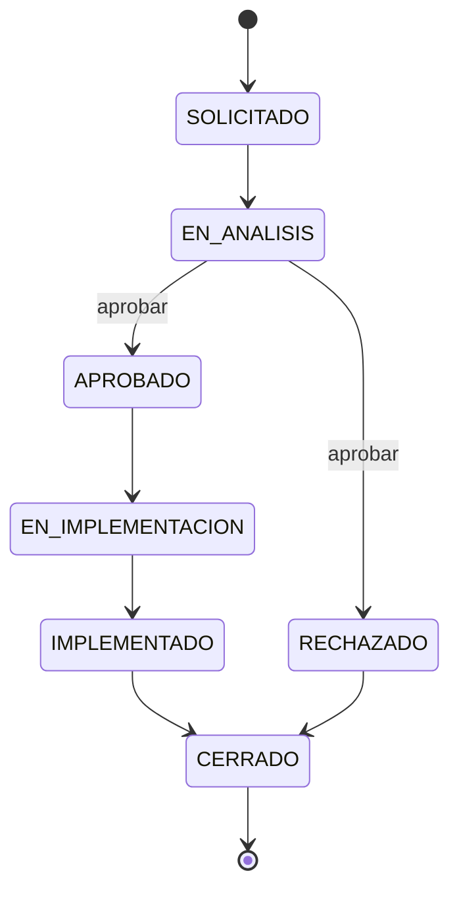
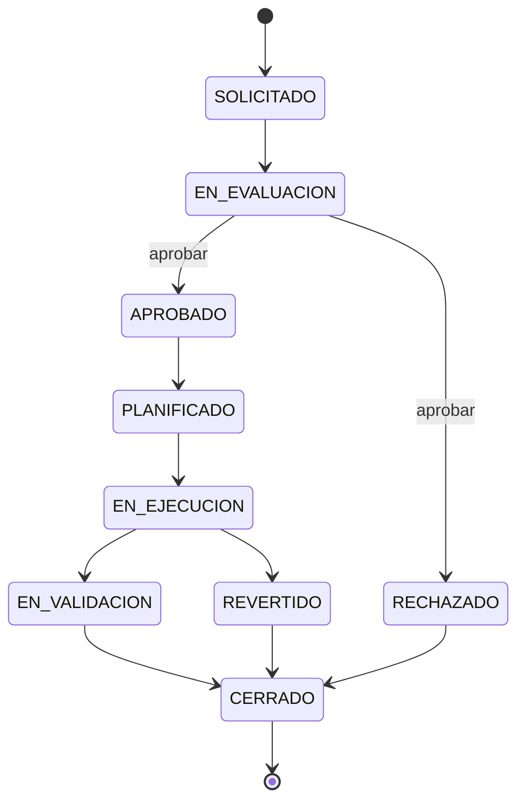
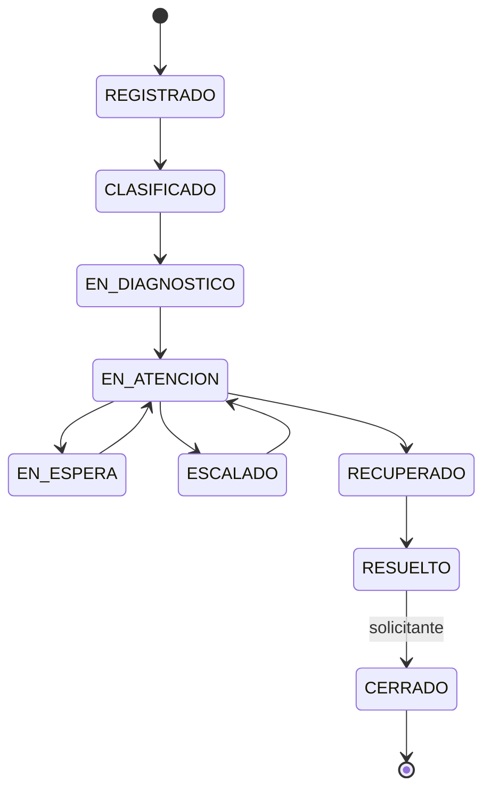
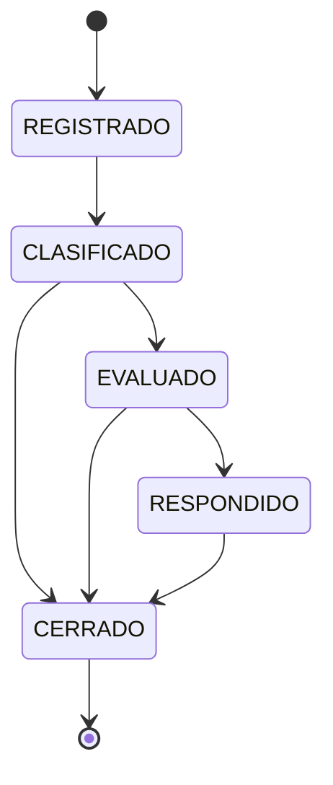
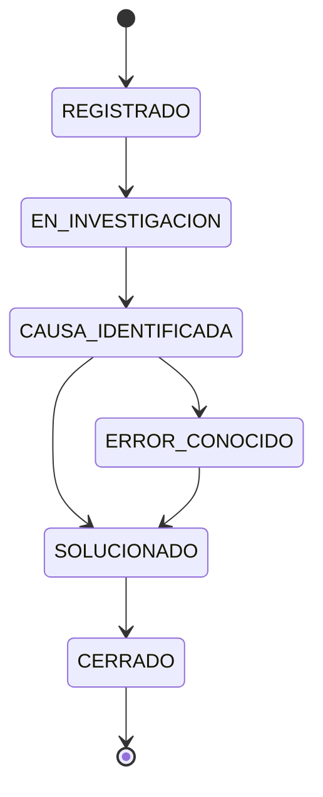
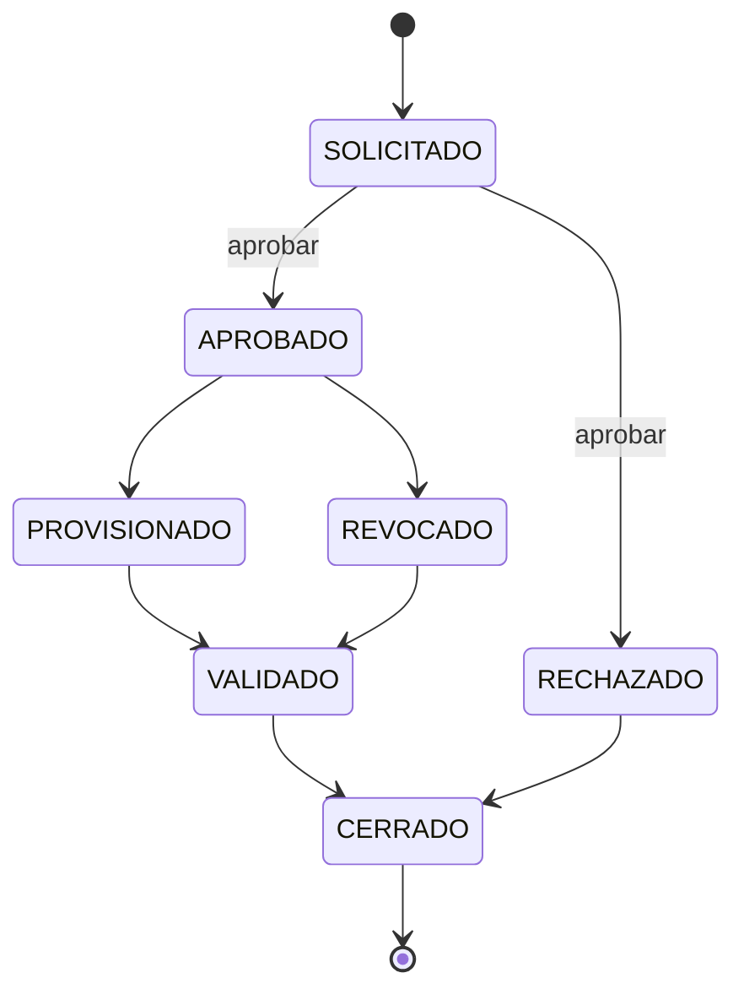
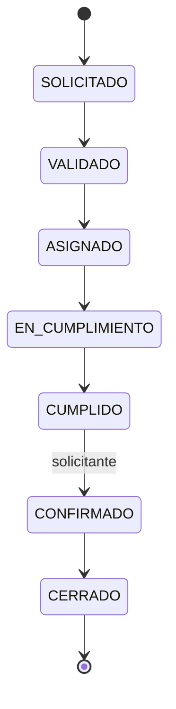

# Procesos, colas, permisos y escalamiento

Fuente de verdad del código: `src/app/services/procesos.py` (flujos), `services/tickets.py` (ejecución) y `services/permisos.py` (autorización). Las tablas de la §5 se generaron desde el código.

## 1. Tipos de ticket (diapositiva 14) ↔ siete procesos
| Proceso de la tarea | Tipo de ticket (diap. 14) | Nota |
|---|---|---|
| Gestión de nuevos servicios | Requisición de servicio | Subtipo `NUEVO_SERVICIO` (lo permite el enunciado §7). |
| Gestión de cambios | Solicitud de cambio | |
| Gestión de incidentes | Incidente | |
| Gestión de eventos | Evento | |
| Gestión de problemas | Problema | |
| Gestión de accesos | Solicitud de acceso | |
| Gestión de servicios de tecnología | Requisición de servicio | Subtipo `SERVICIO_EXISTENTE`: sobre un servicio ya existente del catálogo; se distingue de nuevos servicios (otro flujo) y de incidentes (no hay interrupción). |

## 2. Colas
- Cada cola configura **exactamente uno** de los siete procesos (FK `proceso_codigo`); un proceso puede tener varias colas (ej. `INC-N1`, `INC-N2`, `INC-N3`).
- Campos: código único, nombre, descripción, estado, proceso, nivel de soporte, regla de ordenamiento, objetivos de primera atención y de resolución (minutos), miembros.
- Demostración (`seed_service_desk`): `NS-N1`, `CAM-N2`, `INC-N1`, `INC-N2`, `INC-N3`, `EVT-N1`, `PRB-N2`, `ACC-N1`, `SRV-N1`, `SRV-N1B` (≥ 1 cola funcional por proceso).
- Desactivar una cola con tickets abiertos exige `cola_destino` del mismo proceso; los tickets se mueven con bitácora (no quedan huérfanos). Desactivar un usuario devuelve sus tickets abiertos a la cola sin responsable, con bitácora `LIBERACION`.

## 3. Roles y permisos
Roles: `administrador`, `agente`, `aprobador`, `solicitante`, `consulta` (un usuario puede tener varios: `usuario.rol` + `usuario_rol`).

Permisos por cola (`cola_miembro`, por usuario **o** por rol; se combinan con OR): `consultar`, `atender`, `transferir`, `aprobar`, `administrar`.

| Regla | Dónde |
|---|---|
| Administrador: todos los permisos. | `permisos_cola` |
| `consulta`/`solicitante` sin rol operativo: **nunca** escritura por pertenecer a una cola (se anulan atender/transferir/aprobar/administrar). | `permisos_cola` (P06; Loop 2) |
| `aprobar` exige además el rol `aprobador`; el aprobador no puede ser el solicitante (ni el beneficiario en accesos). | `transicionar` + `CHECK ck_acceso_no_autoaprobado` (P10) |
| Solicitante: crea tickets, ve los suyos, comenta (público), adjunta, confirma y reabre los suyos. | `puede_ver_ticket`, flujos con permiso `solicitante` |
| Agente: ve las colas con `consultar`; actúa con `atender`; mueve con `transferir`. | `permisos_cola` |
| Consulta: lee todo (incluida configuración, CMDB y bitácoras) y no modifica nada. | `exigir_escritura` (403) |

## 4. Asignación, ordenamiento, transferencia y escalamiento
- **Política: mixta.** Manual: un agente con `atender` toma un ticket (`POST /tickets/{id}/tomar`) o un agente con `transferir` lo asigna a otro agente autorizado (`/asignar`). Automática: `POST /colas/{id}/tomar-siguiente` entrega el siguiente según la regla de la cola.
- **Regla determinista:** `PRIORIDAD_ANTIGUEDAD` = prioridad (1 crítica … 4 baja), luego `creado_en`, luego `id`. Alternativa configurable: `ANTIGUEDAD`.
- **Concurrencia:** la toma es un `UPDATE … WHERE responsable_id IS NULL` (solo un agente gana; el otro recibe 409) y `tomar-siguiente` usa `FOR UPDATE SKIP LOCKED`. Las transiciones bloquean la fila (`SELECT … FOR UPDATE`) y aumentan `version` (P07).
- **Transferencia:** exige motivo y cola destino activa **del mismo proceso**; deja el ticket sin responsable en la nueva cola y registra cola, nivel y responsable anteriores y nuevos (P08).
- **Escalamiento:** transferencia a una cola del mismo proceso con **nivel mayor**; un incidente en atención pasa a `ESCALADO`.

### Niveles de soporte (diapositivas 10–13)
| Diapositiva 10–11 (0–4) | Diapositivas 12–13 (0–3) | Nivel configurado |
|---|---|---|
| 0 Comunicación / Autoservicio | 0 Autoservicio (20 %) | 0 Autoservicio (portal + FAQ) |
| 1 Help Desk | 1 Help Desk (70 %) | 1 Help Desk |
| 2 Técnicos de soporte · 3 Ingenieros | 2 Ingenieros (5 %) | 2 Soporte técnico / Ingenieros |
| 4 Proveedores / Externo | 3 Proveedores (5 %) | 3 Proveedores externos |

Diferencia documentada: la diapositiva 11 separa Soporte Técnico e Ingenieros (niveles 2 y 3) y ubica a Externo en el 4; las diapositivas 12–13 los agrupan en 0–3. Se adoptó 0–3 con la columna `equivalencia`, editable por el administrador. **Ruta de escalamiento:** 1 → 2 → 3. Los porcentajes se guardan como referencia (`referencia_porcentaje`); el sistema no los fuerza.

## 5. Flujos de los siete procesos
Toda transición no listada responde **409**; si faltan datos de entrada, **422**; si falta permiso, **403**. Cada transición registra en bitácora el actor, la fecha y los valores anteriores y nuevos. Salida: `CERRADO`. Evidencias: comentarios y adjuntos en cualquier estado.

### Gestión de nuevos servicios (`NUEVO_SERVICIO`)
Estado inicial `SOLICITADO` · resolución en `IMPLEMENTADO`, `RECHAZADO` · reapertura a `EN_ANALISIS`

| Desde | Hacia | Permiso | Datos obligatorios (entrada) |
|---|---|---|---|
| SOLICITADO | EN_ANALISIS | atender | necesidad |
| EN_ANALISIS | APROBADO | aprobar | viabilidad, servicio_propuesto |
| EN_ANALISIS | RECHAZADO | aprobar | motivo_rechazo |
| APROBADO | EN_IMPLEMENTACION | atender | — |
| EN_IMPLEMENTACION | IMPLEMENTADO | atender | servicio_resultante_id |
| IMPLEMENTADO | CERRADO | atender | — |
| RECHAZADO | CERRADO | atender | — |

### Gestión de cambios (`CAMBIO`)
Estado inicial `SOLICITADO` · resolución en `EN_VALIDACION`, `REVERTIDO`, `RECHAZADO` · reapertura a `EN_EVALUACION`

| Desde | Hacia | Permiso | Datos obligatorios (entrada) |
|---|---|---|---|
| SOLICITADO | EN_EVALUACION | atender | ci_afectados |
| EN_EVALUACION | APROBADO | aprobar | impacto_evaluado, riesgo |
| EN_EVALUACION | RECHAZADO | aprobar | motivo_rechazo |
| APROBADO | PLANIFICADO | atender | plan_pruebas, plan_reversion, fecha_programada |
| PLANIFICADO | EN_EJECUCION | atender | aprobado_por_id |
| EN_EJECUCION | EN_VALIDACION | atender | resultado_ejecucion |
| EN_EJECUCION | REVERTIDO | atender | motivo_reversion |
| EN_VALIDACION | CERRADO | atender | validacion |
| REVERTIDO | CERRADO | atender | — |
| RECHAZADO | CERRADO | atender | — |

### Gestión de incidentes (`INCIDENTE`)
Estado inicial `REGISTRADO` · resolución en `RESUELTO` · reapertura a `EN_ATENCION` · pausa en EN_ESPERA

| Desde | Hacia | Permiso | Datos obligatorios (entrada) |
|---|---|---|---|
| REGISTRADO | CLASIFICADO | atender | categoria_incidente, afectacion |
| CLASIFICADO | EN_DIAGNOSTICO | atender | — |
| EN_DIAGNOSTICO | EN_ATENCION | atender | diagnostico |
| EN_ATENCION | EN_ESPERA | atender | motivo_espera |
| EN_ESPERA | EN_ATENCION | atender | — |
| EN_ATENCION | ESCALADO | atender | — |
| ESCALADO | EN_ATENCION | atender | — |
| EN_ATENCION | RECUPERADO | atender | recuperacion |
| RECUPERADO | RESUELTO | atender | solucion |
| RESUELTO | CERRADO | solicitante | — |

### Gestión de eventos (`EVENTO`)
Estado inicial `REGISTRADO` · resolución en `RESPONDIDO` · reapertura a `CLASIFICADO`

| Desde | Hacia | Permiso | Datos obligatorios (entrada) |
|---|---|---|---|
| REGISTRADO | CLASIFICADO | atender | categoria_evento |
| CLASIFICADO | CERRADO | atender | — |
| CLASIFICADO | EVALUADO | atender | evaluacion |
| EVALUADO | CERRADO | atender | — |
| EVALUADO | RESPONDIDO | atender | — |
| RESPONDIDO | CERRADO | atender | — |

### Gestión de problemas (`PROBLEMA`)
Estado inicial `REGISTRADO` · resolución en `SOLUCIONADO` · reapertura a `EN_INVESTIGACION`

| Desde | Hacia | Permiso | Datos obligatorios (entrada) |
|---|---|---|---|
| REGISTRADO | EN_INVESTIGACION | atender | incidentes_vinculados |
| EN_INVESTIGACION | CAUSA_IDENTIFICADA | atender | causa_raiz |
| CAUSA_IDENTIFICADA | ERROR_CONOCIDO | atender | solucion_temporal |
| CAUSA_IDENTIFICADA | SOLUCIONADO | atender | solucion_definitiva |
| ERROR_CONOCIDO | SOLUCIONADO | atender | solucion_definitiva |
| SOLUCIONADO | CERRADO | atender | — |

### Gestión de accesos (`ACCESO`)
Estado inicial `SOLICITADO` · resolución en `VALIDADO`, `RECHAZADO` · reapertura a `SOLICITADO`

| Desde | Hacia | Permiso | Datos obligatorios (entrada) |
|---|---|---|---|
| SOLICITADO | APROBADO | aprobar | beneficiario_id, recurso, permiso, accion_acceso |
| SOLICITADO | RECHAZADO | aprobar | motivo_rechazo |
| APROBADO | PROVISIONADO | atender | — |
| APROBADO | REVOCADO | atender | — |
| PROVISIONADO | VALIDADO | atender | validacion |
| REVOCADO | VALIDADO | atender | validacion |
| VALIDADO | CERRADO | atender | — |
| RECHAZADO | CERRADO | atender | — |

### Gestión de servicios de tecnología (`SERVICIO_TI`)
Estado inicial `SOLICITADO` · resolución en `CUMPLIDO` · reapertura a `EN_CUMPLIMIENTO`

| Desde | Hacia | Permiso | Datos obligatorios (entrada) |
|---|---|---|---|
| SOLICITADO | VALIDADO | atender | validacion |
| VALIDADO | ASIGNADO | atender | responsable_id |
| ASIGNADO | EN_CUMPLIMIENTO | atender | — |
| EN_CUMPLIMIENTO | CUMPLIDO | atender | cumplimiento |
| CUMPLIDO | CONFIRMADO | solicitante | — |
| CONFIRMADO | CERRADO | atender | — |

### Reglas propias de cada proceso
- **Nuevos servicios:** al pasar a `IMPLEMENTADO` se vincula un servicio existente (`servicio_propuesto.vincular_id`) o se crea uno nuevo **solo si su código no existe**; si existe, se vincula (no se duplica). P09.
- **Cambios:** CI afectados obligatorios; aprobación por un aprobador distinto del solicitante; plan de pruebas, plan de reversión y fecha antes de ejecutar; `EN_EJECUCION` exige `aprobado_por_id` (P10). Rama `REVERTIDO`.
- **Incidentes:** clasificación I0–I6 con afectación (interrupción, degradación, ninguna, seguridad), duración estimada y real, prioridad y redundancia; escalamiento; pausa en `EN_ESPERA`; solución obligatoria para resolver; el cierre lo confirma el solicitante o un agente.
- **Eventos:** ver §6. **Problemas:** requiere incidentes vinculados para investigar; causa raíz; error conocido con solución temporal (opcional); solución definitiva; relación con el cambio que la implementa (P13).
- **Accesos:** beneficiario, recurso, permiso y acción (PROVISION / REVOCACION); sin autoaprobación; provisión o revocación según la acción; validación y cierre.
- **Servicios de tecnología:** servicio activo existente; validación, asignación a un agente autorizado, cumplimiento y confirmación del solicitante.
- **Cierre y reapertura:** solo se llega a `CERRADO` desde estados resueltos (o rechazados). Reabrir exige motivo, lo hace el solicitante o un agente, dentro de 7 días y máximo 3 veces; vuelve al estado de reapertura del flujo, limpia `resuelto_en`/`cerrado_en` y queda en bitácora (P15).

## 6. Eventos E0–E3 (diapositiva 15)
| Categoría | Descripción | Respuesta implementada |
|---|---|---|
| E0 | Evento programado | Solo registro: `CLASIFICADO → CERRADO` permitido únicamente para E0. |
| E1 | No programado, sin impacto | Sin respuesta operativa; se conserva la evaluación: `CLASIFICADO → EVALUADO → CERRADO`. |
| E2 | No programado con impacto al servicio | `EVALUADO → RESPONDIDO` crea o vincula un incidente (`EVENTO_GENERA_INCIDENTE`) y genera notificaciones en la aplicación (cola de incidentes y solicitante). |
| E3 | Impacto en seguridad de la información | Igual que E2; el incidente se crea con afectación `SEGURIDAD`. |

Sin duplicados: `POST /api/eventos` usa `huella_evento` (índice único). Procesar la misma huella devuelve el mismo evento e incidente (`duplicado: true`) (P11).

## 7. Incidentes I0–I6 (diapositiva 16)
| Cat. | Rótulo (diapositiva) | Prioridad (agrupación) | Redundancia (agrupación) |
|---|---|---|---|
| I0 | No causa interrupción | BAJA | Existe redundancia |
| I1 | 3 horas o menos (incluye degradaciones) | MEDIA | No existe redundancia |
| I2 | 8 horas o menos (incluye degradaciones) | MEDIA | No existe redundancia |
| I3 | 2 días o menos | ALTA | No existe redundancia |
| I4 | 1 semana o menos | ALTA | No existe redundancia |
| I5 | 1 mes o más | ALTA | No existe redundancia |
| I6 | Afecta la seguridad de los recursos y la información | ALTA | No existe redundancia |

Prioridad numérica del ticket = mínimo entre la matriz impacto × urgencia y la agrupación de la diapositiva (ALTA=2, MEDIA=3, BAJA=4). Las duraciones **no** son SLA de resolución.

**Regla complementaria (DECISIÓN DEL PROYECTO, no de la diapositiva)** — `categoria_por_duracion`:
1. Afectación `SEGURIDAD` → I6; `NINGUNA` → I0.
2. Con duración estimada: la categoría con el **menor límite que la contiene** (resuelve el solape «3 h» ⊂ «8 h»): ≤ 180 min → I1; ≤ 480 → I2; ≤ 2,880 → I3; ≤ 10,080 → I4.
3. Más de 1 semana → I5 (resuelve el hueco sin intervalo entre «1 semana o menos» y «1 mes o más»).
4. Sin duración conocida no se sugiere categoría.
Si la categoría elegida difiere de la sugerida, o la redundancia no coincide con la agrupación, se rechaza (422) salvo que se registre `justificacion_categoria`. Probado en P12.

## 8. Indicadores (tablero) — tiempo **calendario**
| Indicador | Cálculo |
|---|---|
| Tickets por cola, proceso, prioridad y estado | Conteos. |
| Antigüedad | Solo abiertos: ahora − `creado_en`. |
| Tiempo de primera atención | `primera_atencion_en` − `creado_en` (primera toma, asignación o transición de un agente). |
| Tiempo de resolución | `resuelto_en` − `creado_en` − pausas previas a la resolución. |
| Cumplimiento | % de tickets medibles con tiempo ≤ objetivo de su cola. |
Tickets abiertos sin resolución: no entran al promedio de resolución; se cuentan aparte (`tickets_sin_resolver_excluidos`) y en antigüedad. Reaperturas: se usa la última resolución y se informa el total. Probado con datos controlados en P17.
