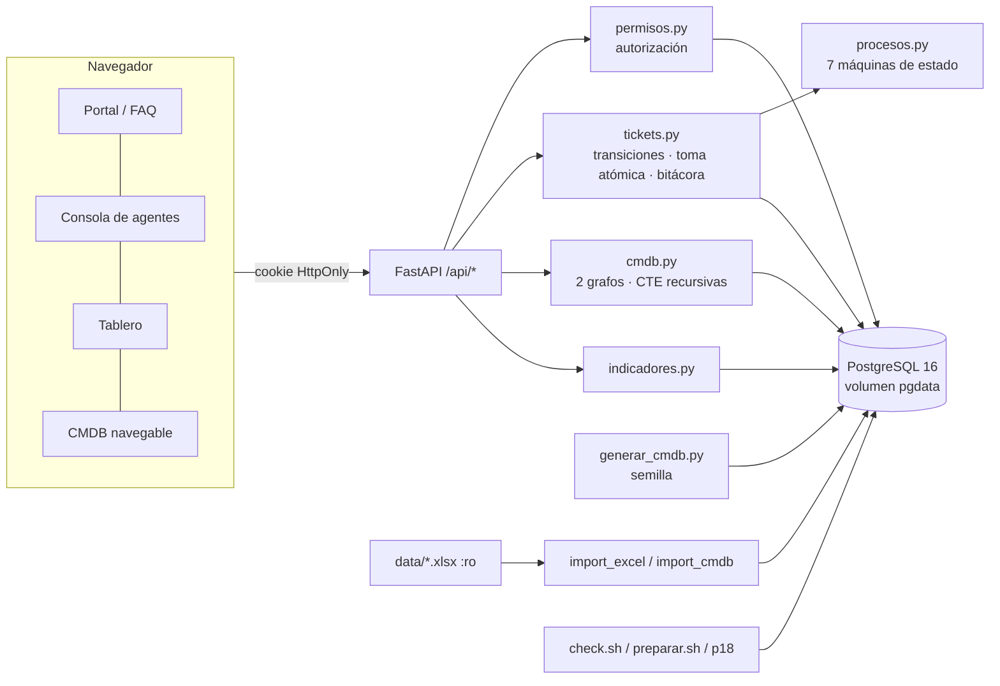

# Resolución — Parcial 3: Service Desk y CMDB con ingeniería asistida por IA

Documentos relacionados: [`MODELO.md`](MODELO.md) (ER, diccionario, jerarquía CMDB, mapeo de fuentes) · [`PROCESOS.md`](PROCESOS.md) (tipos, colas, permisos, flujos, escalamiento, E0–E3, I0–I6, indicadores) · [`IA.md`](IA.md) (prompts, contexto, harness, loops, grafos) · [`PRUEBAS.md`](PRUEBAS.md) (matriz y resultados) · [`RESOLUCION-parcial2.md`](RESOLUCION-parcial2.md) (base conservada).

## 1. Alcance
Se amplió el sistema del parcial 2 hasta un Service Desk que funciona como punto único de contacto: recibe, clasifica, distribuye, atiende y da seguimiento a solicitudes, y cada ticket conserva su servicio, sus responsables, los CI afectados y una bitácora inmutable (quién, cuándo, qué cambió, con qué resultado).

**Incluido:** tickets con creación, consulta, clasificación, asignación, atención, transferencia, escalamiento, resolución, cierre y reapertura controlada; comentarios públicos y notas internas; adjuntos validados; colas con permisos por usuario o rol; siete procesos con flujos propios; eventos E0–E3 e incidentes I0–I6; niveles de soporte configurables; portal del solicitante con FAQ (nivel 0); consola de agentes; tablero de indicadores; CMDB con clasificación jerárquica, 5,000 dispositivos generados con semilla, relaciones técnicas y recorrido de impacto.

**Se conserva del parcial 2:** autenticación local con Argon2id y sesiones revocables, autorización en servidor, bajas lógicas, jerarquía Empresa → Área → Departamento → Sección → Puesto → Usuario, rol de consulta, catálogo 12/46 con el tratamiento de SE.12, celdas combinadas, atributos desconocidos y códigos originales (`data/CatalogoServicios.xlsx` sin modificar, verificado por SHA-256).

**Fuera de alcance:** correo real (las notificaciones son verificables dentro de la aplicación), tiempo hábil (los objetivos usan tiempo calendario), integración con herramientas de monitoreo reales (los eventos entran por `POST /api/eventos`).

## 2. Arquitectura

Capas: rutas (`api.py`, `api_sd.py`) → servicios de negocio (`services/`) → PostgreSQL con restricciones, triggers y transacciones como última barrera. La interfaz es HTML/JS sin compilación y nunca decide permisos.

## 3. Decisiones principales
| Decisión | Motivo |
|---|---|
| Flujos como datos en `procesos.py` + un motor genérico de transiciones | Siete flujos realmente diferenciados (estados, permisos, datos de entrada) sin duplicar código; la documentación se genera desde ellos. |
| Toma con `UPDATE … WHERE responsable_id IS NULL` y `FOR UPDATE SKIP LOCKED` | Evita que dos agentes reclamen el mismo ticket (P07) sin bloqueos largos. |
| Bitácora con trigger inmutable + `anterior`/`nuevo` en JSON | No se puede eliminar historial ni siquiera desde SQL directo (P15). |
| Permisos de escritura solo con rol operativo | El rol consulta no se eleva por error al pertenecer a una cola (P06, Loop 2). |
| Eventos con `huella_evento` única | Reprocesar un evento no duplica ni el evento ni su incidente (P11). |
| Regla complementaria I0–I6 explícita y probada | Los rótulos de la diapositiva se solapan y dejan un hueco; se resuelve como decisión del proyecto, no como dato de la fuente (P12). |
| Jerarquía CMDB con `origen` por fila | Las fuentes solo definen hasta «Tipo de CI»; lo demás se declara como decisión (P04). |
| Generador con códigos derivados de la semilla e `ON CONFLICT DO NOTHING` | Reproducible y sin duplicados; lote identificable y borrable explícitamente (P03). |
| Indicadores en tiempo calendario, descontando pausas | Definición simple y verificable con datos controlados (P17). |

## 4. Limitaciones conocidas
- No se pudo construir la imagen Docker dentro de la sesión de IA (sin acceso al registro de imágenes); el código, las migraciones y las 58 pruebas se verificaron contra PostgreSQL 16 local. La construcción con `docker compose up --build -d` y P18 se registran en `evidencias/resultados-evaluacion-p3.md` al ejecutarlas.
- Nivel 3 de la CMDB es decisión del proyecto (ver MODELO.md §3).
- La interfaz es funcional y sencilla; la API cubre todas las operaciones (`/docs` de FastAPI las lista).
- Los objetivos de atención son por cola y en minutos calendario; no hay calendario laboral.

## 5. Seguridad
Contraseñas Argon2id con sal; sesiones del lado del servidor con token en cookie HttpOnly/SameSite y revocación al cerrar sesión o desactivar el usuario; autorización por petición en el servidor; consulta solo lectura; aprobaciones sin autoaprobación (aplicación + `CHECK`); adjuntos con lista blanca de tipos, máximo 2 MB, SHA-256 y descarga autorizada (`Content-Disposition: attachment`, `nosniff`); notas y adjuntos internos ocultos al solicitante; transacciones con bloqueo de fila en transiciones, asignaciones y transferencias; `.env` fuera del repositorio y de la imagen.

## 6. Docker, persistencia y recuperación
Ver README §3–§7. Datos en el volumen `pgdata`; `stop/start` y `down` (sin `-v`) los conservan (P18). El reinicio destructivo (`down -v`) está separado y documentado; `scripts/preparar.sh` reconstruye todo el conjunto de evaluación de forma idempotente.
